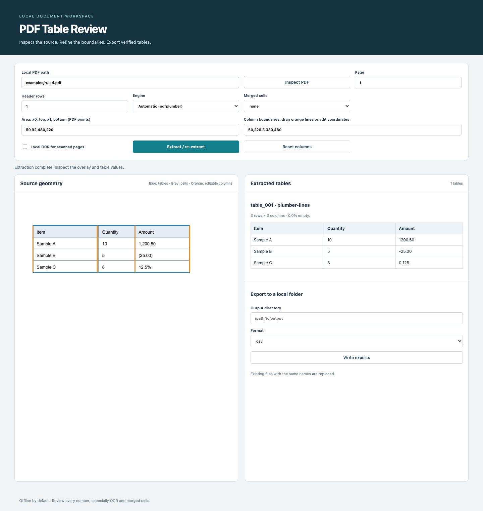

# PDF Table Extract

Extract local PDF tables into CSV, XLSX, or JSON, with page geometry for visual
review, reusable templates, optional offline OCR, and official MCP tools.
Python **3.11+**, version **0.1.0**, MIT licensed. No accounts or paid APIs.



## Quick start

From this repository, three commands install the tool, extract fictional sample
data, and start the review interface:

```sh
python3 -m pip install -e .
pte extract examples/ruled.pdf --out data/example --format csv --json
pte serve --pdf examples/ruled.pdf
```

Open `http://127.0.0.1:8766`. The interface is English, responsive, and entirely
local: no build step, CDN, or browser account is needed. CSV output contains:

```csv
Item,Quantity,Amount
Sample A,10,1200.50
Sample B,5,-25.00
Sample C,8,0.125
```

## Extraction features

- **pdfplumber**: automatically try ruled tables, then aligned-text tables. The
  `auto` and `plumber` engines use this same local strategy selection.
- **Camelot**, optional: choose lattice or stream; `--compare` returns both engines'
  raw tables and whether they agree. It does not silently choose a claimed winner.
- **RapidOCR**, optional: detect pages without a text layer, render them locally,
  and reconstruct a simple aligned table from OCR boxes. Bundled models require
  no runtime download. OCR output is explicitly marked approximate.
- **Multi-page merging**: consecutive pages with the same column count, similar
  headers, and aligned horizontal table extents are joined without repeating the
  header in data rows. Original page regions remain available for review.
- **Merged cells and headers**: `--fill-merged down|right|none` fills absent cells
  in the chosen direction; `--header-rows 2` combines parent/child labels.
- **Selection and cleanup**: page ranges, rectangular regions, explicit column
  boundaries, top/bottom trims, regex exclusions, empty-row removal, and numeric
  column identification.
- **Exact decimal normalization**: thousands separators, parenthesized negatives,
  and percentages use `Decimal`, never float arithmetic. `--keep-numbers` preserves
  source spelling. Values with significant leading zeros stay as text.
- **Quality reports**: row/column counts, empty-cell ratio, numeric column indexes,
  engine, geometry, OCR confidence when applicable, and review notes.

Extraction remains heuristic. A table's geometry or an engine's confidence score
is not proof that every cell is correct; the source overlay makes review possible.

## Optional engines

```sh
python3 -m pip install -e '.[ocr]'
pte extract examples/scanned.pdf --ocr --out data/scan --format csv --json --progress
python3 -m pip install -e '.[camelot]'
pte extract examples/ruled.pdf --compare --out data/comparison --format json --json
pte extract examples/borderless.pdf --engine camelot --camelot-flavor stream --json
```

RapidOCR uses the `rapidocr-onnxruntime` package and its bundled models. OCR is only
used on selected pages without a text layer. Install dependencies ahead of time
for an offline deployment. Optional imports fail with `missing_dependency` and a
clear installation command. No installation or model download happens during
extraction. OCR/model startup takes longer than text extraction.

## CLI reference

Every command supports `--json` and emits one JSON envelope by default. Global
options are `--data-dir`, `--config`, `--json`, `--quiet`, `--progress`, and `--version`,
accepted before or after subcommands. `--progress` sends per-page status to stderr.

| Command | Example |
| --- | --- |
| `inspect` | `pte inspect examples/scanned.pdf --json` |
| `extract` | `pte extract examples/multipage.pdf --pages 1-2 --merge-pages --out data/tables --format xlsx --json` |
| Merged headers | `pte extract examples/merged.pdf --header-rows 2 --fill-merged down --json` |
| Region/columns | `pte extract examples/ruled.pdf --area 50,92,480,220 --columns 50,230,330,480 --json` |
| Cleanup | `pte extract examples/ruled.pdf --trim-top 40 --trim-bottom 40 --exclude-text '^Page [0-9]+' --keep-numbers --json` |
| `render` | `pte render examples/ruled.pdf --page 1 --scale 1.5 --out data/page.png --json` |
| `template save` | `pte template save sample --area 50,92,480,220 --columns 50,230,330,480 --json` |
| `template list/show` | `pte template list --json`; `pte template show sample --json` |
| `template apply` | `pte template apply sample examples/ruled.pdf --out data/batch --format csv --json` |
| `template delete` | `pte template delete sample --yes --json` |
| `export/import` | `pte export --format json --out data/templates.json --json`; `pte import data/templates.json --json` |
| `backup` | `pte backup --out data/backups --json` |
| `serve/mcp` | `pte serve --host 127.0.0.1 --port 8766`; `pte mcp` |

`extract` additional options: `--engine auto|plumber|camelot`, `--ocr`,
`--header-rows N`, `--fill-merged none|down|right`, `--camelot-flavor lattice|stream`,
`--compare`, repeatable `--exclude-text`, and `--utf8` for CSV without BOM.
Omit `--out` to return tables without writing files. Template save accepts all
extraction options or `--from-file OPTIONS.json`; replacement requires `--yes`.
Template apply accepts multiple PDFs and creates one output folder per basename;
duplicate basenames are rejected to avoid overwrites.

## Coordinate system and visual correction

All public coordinates are **PDF points (1/72 inch), origin at the top-left**:
`x0,top,x1,bottom`. Column lists include both outer table edges and every internal
separator. For the ruled example, the area is `50,92,480,220` and column boundaries
are `50,230,330,480`. Camelot's bottom-origin coordinates are converted internally.

In the review UI, inspect the PDF, select a page and options, then extract. Blue
rectangles show tables and gray rectangles show cells; orange lines show editable
column boundaries. Drag a line or edit its coordinate, then click **Extract /
re-extract**. The resulting table and overlay update together. The first extraction
of a single table initializes boundaries automatically. With multiple tables,
select a region and enter its columns. The UI reviews one page at a time; use the
CLI or Python API for cross-page merging. Exports write to the local folder entered
by the user and replace files with the same output names.

## Python API and output schema

```python
from pdf_table_extract import extract_tables

result = extract_tables("examples/multipage.pdf", merge_pages=True)
table = result["tables"][0]
print(table["headers"], table["rows"], table["quality"])
```

`inspect_pdf` is also public. Output includes source name/SHA-1, page count,
tables, warnings, optional engine comparisons, and exported file paths. Every table
has headers, rows, raw rows, source pages, geometry, engine and quality metadata.
Numeric values are decimal **strings** to preserve precision. The packaged
[JSON Schema](src/pdf_table_extract/core/result.schema.json) is validated at runtime
and in tests. See [docs/format.md](docs/format.md) for semantics and limitations.

CSV exports use UTF-8 with BOM by default. XLSX puts each table in a worksheet,
preserves values as text (including decimal precision and leading zeros), and
does not turn strings into formulas. CSV preserves source text; spreadsheet apps
may interpret formula-like text themselves. Every export writes `quality.json`.

## Templates, configuration and backup

Extraction results are not cached or stored implicitly. Reusable templates live
in `DATA_DIR/cache.sqlite`. Default data directory: `./data`; precedence is
`--data-dir`, `PTE_DATA_DIR`, explicit TOML `data_dir`, then default. Configuration
requires `--config FILE`; see [examples/config.toml](examples/config.toml).
Backup timestamps default to `Asia/Shanghai`, configurable with TOML `timezone`.

`export` and `import` transfer **templates**, as JSON or UTF-8-BOM CSV. Existing
template names are skipped on import; duplicates within an import are rejected.
Imports validate the complete batch before updating the SQLite transaction.
`backup` uses SQLite's online backup API and returns a dated ZIP. It contains the
template database, not source PDFs or exported tables. Stop the application before
restoring `cache.sqlite` into a new empty data directory. Back up before replacing
or deleting templates. Keep real PDFs, exports and credentials out of public Git.

## MCP

The official SDK provides `inspect_pdf(path)` and `extract_tables(path, pages?,
format?, merge_pages?, out?, engine?, ocr?, header_rows?, fill_merged?, area?, columns?)`.
The extraction tool documents its file-write side effect when `out` is set.
Schemas: [docs/mcp-tools.json](docs/mcp-tools.json).

```json
{
  "mcpServers": {
    "pdf-table-extract": {
      "command": "/workspace/apps/pdf-table-extract/.venv/bin/pte",
      "args": ["--data-dir", "/workspace/data/pdf-table-extract", "mcp"]
    }
  }
}
```

## Fixtures and verification

Six fictional PDFs under `examples/` cover ruled, borderless, two-page, merged-cell,
side-by-side table, and scanned-image layouts. Their seven expected CSV files are
human-readable. Regenerate them with `python examples/generate.py` after installing
the development extra. No real names, organizations, prices or accounts appear.

```sh
python3 -m pip install -e '.[dev,ocr,camelot]'
ruff check .
ruff format --check .
pytest -q --cov=pdf_table_extract --cov-report=term-missing
```

The suite compares exact extracted rows to expected CSVs, including actual local
RapidOCR and actual Camelot when those extras are installed, reopens XLSX with
openpyxl, validates JSON, tests coordinate selection/merging/Decimal handling,
templates, CLI, MCP and HTTP review. CI covers Python 3.11/3.12 and an additional
optional-engine job. Local browser verification covers desktop/mobile rendering,
column dragging and correct re-extraction. The `agent-skills-kit` PDF wrapper has
also been run against the real `pte` executable and matched the expected CSV.

## FAQ and limits

**Why is a scan empty without `--ocr`?** An image-only page has no text layer. The
tool reports that explicitly; it does not fabricate tables from missing text.

**Are complicated scans supported?** OCR reconstruction currently targets one
simple aligned table in the selected region. Multiple tables, skew, handwriting,
rotated layouts, and complex merged OCR cells need manual review or separate areas.

**Why did a borderless column merge?** Word alignment can split a phrase into
adjacent columns. Blank header fragments are joined to the previous named column,
with an explicit quality note. If the original has an intentionally unnamed column,
set explicit boundaries and review the result.

**Do empty cells get filled automatically?** Only absent merged cells (`null`) are
filled when requested. Real empty strings are preserved. Header parents propagate
rightward through absent header cells. Inferred structure can still need correction.

**Can it crack protected PDFs or edit PDFs?** No. Provide a legitimately unlocked
copy. This tool extracts and renders; it does not provide general PDF editing.

**Can the review server be public?** It has no account system and can read local
PDF paths and write requested export paths. Keep the default loopback binding.
Same-origin checks protect browser requests, not mutually untrusted local users.

Roadmap: better OCR table segmentation, explicit per-page templates, and review
annotations. See [AGENTS.md](AGENTS.md), [CHANGELOG.md](CHANGELOG.md), and [LICENSE](LICENSE).
